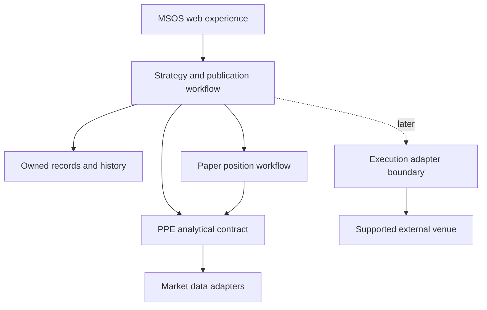

# MSOS 2.0 — Product and Technical Blueprint

**Version:** 0.1 — first discussion draft  
**Date:** 2026-11-16  
**Status:** PROPOSED; not an accepted implementation specification  
**Product owner / reviewer:** Daniel Tabakman  
**Canonical repository:** DanielTabakman/Probability-prediction-engine  
**Evidence baseline:** main at `8f00ff4b51086aa052a3c8fd387359417cd79abd`

> This document records a proposed direction for review. Its publication authorizes no product implementation, migration, task-queue change, automated build campaign, merge to production, or deployment. It does not supersede existing controlling documents. Only this new document is in scope for the current task.

## 1. Product thesis and intended outcome

**Proposed definition:** Market Structure OS lets options traders turn a trade idea into a clear, testable, shareable strategy that another trader can inspect and independently adopt.

The longer-term workflow is **create → analyze → publish → independently copy → execute where supported → monitor and review**. The initial release proves the creator-to-copier workflow through simulation. Live execution through external venues remains part of the intended destination, subject to technical feasibility, user eligibility, and a separate release decision.

The core product object is a versioned strategy. PPE supplies analytical capabilities. MSOS supplies the user workflow, ownership, publication, and position history. A community of creators and users supplies feedback about whether that workflow solves a recurring problem.

**Commercial hypothesis, not established demand:** options traders who currently communicate trades through screenshots, spreadsheets, and chat messages will value a link that preserves the exact structure, assumptions, analytical context, and a reproducible path to adopting it.

**Initial user hypothesis:**

- **Creator:** already understands options and wants to construct and explain a concrete trade.
- **Copier:** understands basic options mechanics, wants to inspect the trade, change their own size, and decide independently.
- **Founder/operator:** recruits testers, resolves workflow failures, and studies repeat use.

The first audience is not every investor. Beginner education, a broad social network, and autonomous portfolio management would introduce additional product requirements.

**Success means:** another person can understand what was proposed, identify what has changed since publication, and create their own traceable paper position. Registration counts and attractive charts alone do not establish this.

## 2. Design and migration principles

1. Design the target workflow before deciding which legacy components to preserve.
2. Reuse proven behavior when its inputs, outputs, ownership, and limitations fit the new contract. Existing code is a candidate, not a requirement.
3. Prefer an incremental redesign within the canonical PPE/MSOS repository. A new application, repository, framework, or language migration is not approved or presumed necessary.
4. Keep options calculations authoritative in Python. The web application consumes versioned analytical contracts and handles presentation and workflow.
5. Separate the strategy proposal, analytical evidence, publication, and each user's position.
6. Preserve old records and interfaces until replacements and migration evidence justify retirement.
7. Keep the first release narrow enough to exercise a complete real user journey.
8. Keep Autobuilder separate from product ownership. Do not make build-factory changes a prerequisite unless a demonstrated implementation blocker requires them.

The method is selective replacement: define boundaries, characterize existing behavior, introduce the new workflow in isolation, and migrate deliberately. The exact replacement scope remains an audit decision.

## 3. Evidence, assumptions, and limits of this draft

**Fact** means a file or contract was inspected at the recorded baseline; it does not establish production health. **Proposal** means a recommended design or scope choice. **Unverified** means evidence is still needed.

| Evidence | Verified observation | Limit |
|---|---|---|
| [Frontend package](../../apps/msos-web/package.json) | A Next.js/React/TypeScript application exists at `apps/msos-web`. | No frontend build or deployed UI was exercised for this draft. |
| [Strategy scanner](../../src/engine/strategy_scanner.py) | Python code uses a particular four-leg representation with `k1`–`k4` and polarity controls. | General arbitrary-leg correctness and supported payoff coverage are not established. |
| [Python suggestion boundary](../../src/viz/strategy_suggestion_boundary.py) and [web consumer](../../apps/msos-web/src/lib/ppeStrategySuggestion.ts) | A read-only analytical boundary already returns strategy legs, payoff data, and summaries to the frontend. | Suitability as the new authoritative strategy contract is unproven. |
| [Existing journey](../../apps/msos-web/src/lib/strategyLabWorkflow.ts) | The UI defines Compare view → Confirm view → Plan paper trade. | This does not establish a working multi-user publishing/copying journey. |
| [Expression persistence](../../apps/msos-web/src/lib/expressionPersistence.ts) | Planned/simulated expressions, saved marks, and open/closed/expired paper-trade statuses exist. | Display-oriented leg strings and optional metadata require review before migration. |
| [Workflow store](../../apps/msos-web/src/lib/msosWorkflowStore.ts) | A JSON-file store contains theses, expressions, related objects, and owner pointers. | Concurrent writes, transactional integrity, and suitability for a shared product have not been validated. |
| [Snapshot reviews](../../apps/msos-web/src/lib/snapshotReview.ts) | SQLite-backed frozen analysis and review access exists. | Analytical snapshots are not equivalent to immutable strategy versions or executed positions. |
| [Workflow identity](../../apps/msos-web/src/lib/msosWorkflowAuth.ts) | Request identity can use headers or a session cookie, with a development anonymous mode. | Durable cross-device identity and publication permissions need an end-to-end review. |
| [Options Market Read contract](../API/OPTIONS_MARKET_READ_V1.md) | A documented informational analytical API exists. The inspected v1 contract says BTC only. | Current ETH/other-asset support and live endpoint behavior were not verified. |
| [Earlier routing ADR](../SOP/MSOS_P1_STACK_ROUTING_ADR.md) and [current boundaries](../REPOSITORY_BOUNDARIES.md) | Historical embedding approaches coexist with newer restrictions on runtime iframes. | Historical plans must not be treated as current implementation instructions. |
| [Autobuilder README](https://github.com/DanielTabakman/msos-autobuilder/blob/main/README.md) | Factory infrastructure is separately owned and documents controlled draft publication. | No worker, queue, or persistent-host status was inspected. |

This is a targeted source review, not a complete architecture, security, numerical-correctness, deployment, or commercial audit. No claim is made that all proposed missing capabilities are absent everywhere in the repository.

**Assessment:** confidence 85% in blueprint-first selective migration because useful components and conflicting historical assumptions are visible. Confidence in market demand is unmeasured pending user trials.

## 4. Proposed first-release boundary

| Dimension | Initial proposal | Deferred |
|---|---|---|
| Underlying | BTC first; one verified instrument catalogue | ETH, other assets, RWA options |
| Instruments | One venue's explicitly supported listed European options and settlement convention | Cross-venue packages, mixed settlement types |
| Strategy size | Up to four legs, one expiry; a leg-list model with explicit ratios | Calendars, arbitrary numbers of legs, dynamic rules |
| Supported structures | Long options, matched vertical spreads, and fully specified defined-risk four-leg structures after numerical verification | Naked short options and unvalidated structures |
| Analysis | Expiry payoff/P&L, costs, breakevens, supported risk bounds, source and assumption visibility | Full backtesting, unsupported Greeks, liquidation/margin simulation |
| Sharing | An explicit publication link; a small curated tester list if needed | Public discovery ranking, feeds, comments, creator monetization |
| Copying | Exact published contracts with a fresh analysis and independent sizing | Automatic following or silent replacement with equivalent contracts |
| Positions | Private paper positions with recorded entry assumptions and review | Live orders, custody, wallets, autonomous adjustments |
| Storage | Durable records with owner checks and transactional writes | Infrastructure selected for speculative scale |
| Community | A small recruited cohort with observed tasks | Broad audience acquisition before retention evidence |

The instrument catalogue and source venue are not selected by this document. Contract settlement and quote conventions must be verified before supporting a structure. "Defined risk" must be calculated for the actual contract convention; a familiar strategy name is insufficient evidence.

The scope is deliberately narrower than the eventual product. Users should see available capabilities and honest unsupported states.

## 5. First complete user journey

### Creator

1. Sign in and start a private strategy draft.
2. Choose supported contracts and leg ratios, optionally beginning from a validated template.
3. Add a title, trade thesis, intended horizon, and the circumstances that would undermine the thesis.
4. Analyze against an identified market-data snapshot. See costs, expiry payoff/P&L, supported risk bounds, data age, and material limitations.
5. Save an immutable strategy version. Publish that version with selected explanatory content and an attached analysis snapshot.
6. Share the publication link. Later edits create a new version; they do not overwrite the published historical record.

### Copier

1. Open the publication and inspect its exact contracts, ratios, thesis, original timestamp, and original analysis.
2. Request a new analysis using current available data. Clearly distinguish the creator's original example from the copier's prospective entry.
3. Choose an independent package size. Preserve the leg ratios and apply instrument quantity constraints.
4. Review the resulting exposure, entry assumptions, fees, data age, and simulation label.
5. Explicitly save a private paper position. Store lineage to the publication/version and the copier's entry analysis.
6. Reopen the position later, obtain a supported current valuation or an honest unavailable/stale state, and record review or closure.

### Copy semantics

- Copy means adopt the exact supported contracts and ratios, with the copier's chosen package size.
- Editing legs creates a derived strategy version with provenance; it is no longer an exact copy.
- Expired, delisted, unsupported, or inadequately quoted contracts block a new copy. They remain viewable as historical records where access permits.
- A publication never authorizes transactions in another person's account.
- Creator revisions do not change existing copies or automatically rebalance positions.
- Copying an idea using different strikes/expiries is a separate future workflow with an explicit comparison and confirmation.
- Unpublishing prevents further public access/copying according to policy, but does not erase the minimum provenance already attached to another user's private position. The retained content and privacy policy require review.

## 6. Proposed domain model

These are conceptual contracts, not an instruction to create tables or routes now.

| Entity | Responsibility and minimum information |
|---|---|
| **InstrumentSpec** | Internal ID, venue instrument ID, underlying, option right, strike, expiry timestamp, exercise style, contract multiplier, quote currency, settlement currency/method, quantity step, source/version. |
| **StrategyDraft** | Owner, mutable proposed legs, thesis, supported-scope validation, last update. |
| **StrategyVersion** | Immutable ID, strategy ID, version, owner, normalized leg list and ratios, instrument-spec references, thesis/assumptions, schema version, creation time, content hash. |
| **MarketSnapshot** | Source, observed/captured times, per-leg prices and quote types, underlying inputs, currency conversions, data-quality/freshness flags. |
| **AnalysisSnapshot** | Strategy version/hash, market snapshot, analytics-engine/method version, assumptions, outputs, units, warnings, support status. |
| **Publication** | Creator's public identity, pinned strategy version, selected analysis, explanatory content, visibility, publication/unpublication timestamps. |
| **PaperPosition** | Owner, source publication/version, independent size, entry analysis, assumed prices/fees, simulation-method version, lifecycle events. |
| **PositionValuation** | Position ID, valuation snapshot, timestamp, valuation basis, supported P&L outputs and quality state; does not overwrite entry evidence. |
| **ExecutionPackage** — later | Exact instruments, leg quantities, venue, package price constraint, validity window, account context and required capabilities. |
| **ExecutionAttempt/Result** — later | Idempotency key, package hash, user confirmation context, venue references, acknowledgements, fills/rejections, reconciliation state. |

**Invariants:**

- A strategy is represented as legs, not fixed fields named after four slots. The first UI may enforce four legs while the model remains explicit.
- Every leg has a stable contract reference. Display strings such as "BTC Call" or "$80,000" are presentation, not contract identity.
- Financial values have explicit units and controlled decimal precision. Positive package size plus BUY/SELL and leg ratio avoids ambiguous signed quantities.
- A strategy hash excludes changeable market prices; an analysis separately identifies its data and method.
- Repeated save requests with the same idempotency key cannot create duplicate positions.
- Published versions and entry records are immutable. Corrections append a new version or event.
- Drafts and positions are private by default. Publication uses an explicit safe projection; account identifiers and private portfolio details are excluded.
- Owners of legacy records must be resolved explicitly. Unknown ownership is not permission to expose a record.
- Missing results are represented as unsupported/unavailable, never silently as zero or a fixture.

## 7. Proposed technical architecture and ownership

Use a modular web application plus the existing Python analytical boundary as the initial architectural candidate. Do not introduce a service for each entity.

| Module | Owns | Boundary |
|---|---|---|
| MSOS UI | Authoring, analysis presentation, publication and position pages | Does not calculate a second version of financial outputs or imply a venue fill occurred |
| Strategy/workflow module | Versions, validation coordination, ownership, permissions, copy provenance | Uses canonical instrument and analytical contracts |
| PPE analytics | Supported normalization/valuation, payoff calculations, model outputs, analytical warnings | No publication permission decisions or order submission |
| Market data adapters | Catalogue and quote acquisition, source metadata, freshness | Never convert missing quotes into apparently valid prices |
| Paper workflow | Entry assumptions, position events, valuations and review | Always distinguish simulated activity from actual trades |
| Persistence | Transactional writes, immutable history, migrations, access-scoped reads | Explicit table/schema ownership; avoid multiple runtimes independently editing one schema |
| Future execution adapter | Capability checks, package translation, order lifecycle, reconciliation | Exact venue-specific semantics; never promise universal atomic execution |
| Autobuilder | Delivery of separately authorized implementation work | Consumes bounded product tasks; does not own the product definition |

**Persistence proposal:** prefer a transactional application store for new shared workflow records. SQLite is a candidate for a single-host pilot if concurrency and backup tests pass; a multi-instance deployment may require another database. Decide from actual deployment constraints. Do not automatically carry forward the current JSON-file write model or replace every existing SQLite store.

**Illustrative interfaces:** validate a strategy; analyze a pinned version and snapshot; publish a version; prepare an exact copy; save a paper position idempotently; value/review a position. Names, URLs, and schema fields are not frozen in this draft.

All analytical responses should identify schema version, request correlation, strategy hash, snapshot ID/timestamps, method version, units, support status, and warnings. Errors should distinguish invalid inputs, unsupported structure, unavailable instrument, stale/missing data, and upstream failure.

## 8. Analytical and simulation integrity

The first release must earn trust through traceability and explicit limits.

- Show **expiry payoff** separately from **P&L after premium and fees** and from **valuation before expiry**.
- Preserve premium, quote and settlement conventions. Currency conversion uses an identified rate and timestamp.
- An options-implied distribution describes a model derived from market prices; it is not automatically a real-world forecast. User beliefs must be labeled separately.
- Do not display probability of profit, expected return, or risk bounds without identifying the model, supported domain, and necessary inputs.
- Apply one documented numerical method in Python; validate at strike boundaries and extreme underlying values, not only on a plotted grid.
- A new copy uses a coherent snapshot with a specified maximum age and allowable time skew across legs. Select and document the numerical thresholds after inspecting the feed.
- Prefer side-aware bid/ask assumptions where available, with explicit fees and depth limitations. Mark-based alternatives remain labeled theoretical paper entries and are not included in executable-price comparisons.
- Independently quoted legs are not evidence that a package can fill simultaneously.
- Store the simulation method and assumptions at entry. Later method changes do not rewrite the original entry.
- If pre-expiry valuation or expiry settlement data is unavailable, preserve the position and show that limitation; do not fabricate realized performance.
- Margin, liquidation, and early-close execution risks are not modeled merely because an expiry payoff chart is available.

## 9. Initial reuse and migration map

Every disposition below is a proposal pending characterization tests and dependency review. "Retire" describes an eventual outcome, never an action authorized by this draft.

| Component | Proposed disposition | Required evidence / modification |
|---|---|---|
| Next.js application and reusable UI | **Keep/adapt** | Identify reusable components; validate existing routes and isolate the new journey before cutover. |
| Strategy Lab compare/confirm/plan journey | **Adapt** | Let users construct and publish a strategy without forcing unrelated legacy workflow steps. Preserve useful explanations. |
| Python distribution/payoff utilities | **Keep/adapt** | Numerical fixtures, settlement/units audit, deterministic outputs, explicit supported coverage. |
| Fixed four-slot strategy representation | **Adapt or replace at boundary** | Translate to canonical legs only where semantics are exact. Remove fixed-slot assumptions from new domain ownership. |
| Existing strategy-suggestion API and web adapter | **Adapt** | Retain useful calculation boundary; add precise instruments, provenance, versions, units and errors as needed. |
| Expression and paper-trade records | **Adapt** | Map existing lifecycle/marks into positions. Display strings or missing metadata may require read-only legacy treatment. |
| JSON workflow store | **Replacement candidate** | Demonstrate transactional durability and multi-user isolation; build an explicit importer if replaced. |
| Frozen evaluations and review history | **Keep; link selectively** | Preserve source IDs and provenance; do not relabel old analyses as executable strategies or fills. |
| Identity and ownership controls | **Audit/adapt** | Verify private reads/writes, publication projections, durable identity and development-only fallbacks. |
| Options Market Read API | **Keep separately bounded** | Preserve its informational contract; use underlying analytical capabilities without widening external promises silently. |
| Python Streamlit lab | **Keep during migration; review later** | Determine whether it remains a useful research/operator surface after user workflows move. |
| Historical embed designs, fixtures, obsolete plans | **Archive/retire later** | Identify active dependencies and authoritative replacements first. Fixtures must not masquerade as live data. |
| Autobuilder | **Keep separate** | No factory redesign for this draft; later tasks need explicit paths and acceptance criteria. |
| Publishing, exact-copy provenance, execution adapters | **New or extend after audit** | No complete working implementation has been verified in this review. Search and characterize before rebuilding. |

Legacy conversion must never guess venue, settlement, size, or historical prices from prose. Ambiguous records remain accessible as labeled legacy records; they are not eligible for exact copying until validated.

## 10. Live execution feasibility track — investigate before commitment

Implementing live execution comes later, but establish whether the intended workflow is feasible before freezing contracts.

| Candidate | Why examine it | Current evidence status |
|---|---|---|
| Deribit | Candidate options venue from the product discussion | Package/RFQ capabilities, integration terms, account access and permitted user locations unverified here |
| Derive | Candidate onchain options venue from the product discussion | Same; onchain availability does not establish eligibility or atomicity |
| Paradex | Candidate mentioned in the product discussion | Suitability for the proposed listed-options workflow itself is unverified |

Do not treat these as endorsed integrations. A venue decision requires current primary documentation and, where necessary, direct confirmation:

1. Supported contracts, settlement and quantity conventions.
2. Whether the whole package is quoted/executed together and what guarantees actually apply.
3. Quote expiry, price constraints, partial fills, rejected legs, retry behavior and idempotency.
4. Authentication, signing, account authority, rate limits and reconciliation.
5. Data use/redistribution terms, supported jurisdictions and any professional review needed for the intended operating model.
6. Fees, capital requirements and operational failure handling.

**Decision gate:** record one credible supported execution path and its limitations, or explicitly retain a standalone research/paper product thesis. Do not solve an unsupported package by silently executing legs sequentially.

No credentials, accounts, live orders, or venue-side changes are part of this blueprint task.

## 11. Founding tester experiment

**Proposed cohort:** 3 creators and 5 independent copiers recruited for a two-week pilot once the first workflow is usable. These are planning targets, not existing commitments.

Ask each creator to publish at least one strategy. Observe copiers explaining the structure and assumptions, obtaining their own analysis, and deciding whether to save a paper position. Rejection with a clear reason is useful feedback.

| Question | Proposed initial evidence |
|---|---|
| Can people use it? | At least 4 of 5 copiers complete the supported workflow; record where founder help was required. |
| Does the explanation transfer? | Each successful copier can identify contracts, expiry, risk limits/limitations and the difference between original and current entry assumptions. |
| Does the workflow recur? | At least 2 creators publish again and 3 copiers return to review or adopt another strategy. |
| Is there durable demand? | Record repeated unsolicited use, a concrete willingness to pay, or a specific request to enable execution. |
| Does it preserve trust? | Zero observed ownership/version corruption and no simulated trade presented as a real fill. |

These thresholds are a proposed continue/revise discussion rule, not statistical proof. Instrument a small event set: version saved, publication opened, fresh analysis completed, copy blocked/reason, paper position saved, position revisited, repeat publication. Minimize recorded personal data.

Pricing, grant applications, and broader community growth follow evidence; they do not substitute for it.

## 12. Proposed implementation sequence and gates

**All phases below are future proposals. This document does not enqueue or start them.**

| Phase | Work | Exit evidence |
|---|---|---|
| 0 — Review the blueprint | Agree on first user, exact-copy semantics, initial scope, and boundaries; list unresolved decisions | Accepted scope/version and explicit authorization for the next phase |
| 1 — Characterize and test feasibility | Trace existing workflow, persistence, identities, calculations and deployments; research one venue path | Verified inventory, characterization cases, migration candidates and feasibility report |
| 2 — Define contracts and isolate a pilot | Finalize instrument/strategy/analysis schemas, transactional store decision and access rules | Contract fixtures pass; old behavior preserved; isolated environment and rollback route established |
| 3 — Prove one complete journey | Create → analyze → publish → fresh exact copy → private paper position → revisit | Two distinct user identities complete it with immutable provenance and honest pricing |
| 4 — Run the tester pilot | Recruit the small cohort, observe use and fix demonstrated blockers | Measured activation, comprehension, repeat use and explicit continue/revise decision |
| 5 — Migrate selectively | Import eligible legacy records; switch only the agreed surfaces | Counts/provenance reconcile; ambiguous records preserved; rollback exercised |
| 6 — Consider live execution | Add a verified adapter only after a separate decision | Venue/test-environment evidence, failure handling, reconciliation and an approved rollout plan |

Do not estimate a full rewrite schedule before Phase 1. The first implementation plan should describe a small number of independently demonstrable milestones, not a large speculative backlog.

## 13. First-release acceptance criteria

A release candidate must demonstrate all applicable criteria, not merely contain matching code:

- Two independently authenticated users complete the full journey.
- User B cannot read or mutate user A's private drafts, positions or unpublished analysis.
- Publication exposes only approved public fields.
- Editing a creator draft creates a new version; old publications and copied positions remain reproducible.
- Copying preserves exact contracts/ratios, validates quantity steps, and records independent size and entry assumptions.
- Expired/unsupported contracts and stale/incomplete data fail visibly.
- Numerical checks cover every supported structure, contract convention, premium sign, fees, currency units, boundaries and risk limits.
- Repeated save requests do not duplicate positions; concurrent writes do not lose another user's work.
- A service restart preserves positions and history; backup restoration is demonstrated.
- Historical and current analysis are visibly distinguished.
- Paper entries and valuations show their pricing method; no order or fill claim appears without corresponding venue evidence.
- Existing supported APIs and the current application retain their agreed behavior during the isolated pilot.
- A rollback rehearsal demonstrates how the pilot can be disabled without losing pilot records or corrupting legacy data.

## 14. Migration, rollback and operating discipline

Before migration, export and back up affected records, capture source schema versions, and classify record eligibility. Use an idempotent importer with original IDs, import mapping, validation results and reconciliation counts.

Prefer one authoritative writer per record family. Avoid indefinite dual writes. If a cutover needs synchronization, define its duration, failure recovery and reconciliation before starting it.

Use additive schema changes and an isolated preview/test surface first. On a pilot failure, route users back to the current workflow, preserve new records for investigation/export, and restore service without forcing new records into incompatible old schemas.

Retirement requires a confirmed replacement, successful reconciliation, a retained archive/access policy and a separate scoped change. Never delete old history as a convenience for the rebuild.

## 15. Decisions for the next review

| Decision | Recommended starting answer | What could change it |
|---|---|---|
| First users | Options-literate creators and independent copiers | Interviews reveal a more specific recurring need |
| First asset | BTC; ETH next after evidence | Verified catalogue and tester demand make another choice simpler |
| First structures | Same expiry, up to four legs, validated risk-limited templates | Venue conventions or analytics coverage require a narrower set |
| Copy meaning | Exact contracts/ratios, fresh analysis, own size | Users primarily want to reproduce ideas after original contracts expire |
| Main user value | A reproducible strategy link with analytical context | Users repeatedly prefer only private construction or only execution |
| Sharing | Explicit link publication and a small cohort | Access needs require invite-only sharing |
| Architecture | Existing web app plus Python analytical boundary | Dependency audit shows isolation/replacement is cheaper and safer |
| Persistence | Transactional store with explicit ownership | Deployment constraints determine SQLite versus another database |
| Live integration | Investigate now, implement after separate approval | No credible execution path requires revisiting the product thesis |
| Scope of replacement | Decide component by component | Characterization and migration cost justify replacing a larger unit |

Approval of a future blueprint version must explicitly distinguish accepted decisions, remaining assumptions, and implementation scope. Saving this first draft is not that approval.

## 16. Next concrete deliverable

Review this document, resolve the high-impact decisions in section 15, and produce version 0.2 with the corrections. Then, if authorized, complete the bounded current-state audit and convert the first full user journey into an implementation plan.

The operating rule is: **design the product afresh; make each replacement earn its cost.**

---

### Document provenance

Prepared from the [shared blueprint handoff](https://chatgpt.com/share/6afb3cd4-0010-83ea-a640-a302854bd58c), the subsequent product review, and a targeted read of the repository at the baseline above. Relative evidence links refer to files in the repository; use the recorded commit for reproducible historical review. The Autobuilder link is a separately owned source read during preparation.

No production or runtime claims were tested for this draft. No venue capabilities, legal eligibility, user demand, performance statistics, or implementation estimates are presented as verified.
